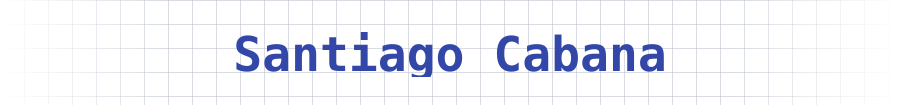

<h1 align="center">
  
</h1>

  <strong>Full Stack Developer · Backend · Automation · Scalable Systems</strong>

Técnico profesional en Ingeniería de Software con IA

<table align="center">
  <tr>
    <th width="33%" align="center">Backend</th>
    <th width="34%" align="center">Frontend</th>
    <th width="33%" align="center">Infra y automatización</th>
  </tr>
  <tr>
    <td align="center" valign="top">
       
    </td>
    <td align="center" valign="top">
       
    </td>
    <td align="center" valign="top">
       
      
      
      
    </td>
  </tr>
</table>

<strong>Herramientas de desarrollo con IA</strong>

  
  
  

